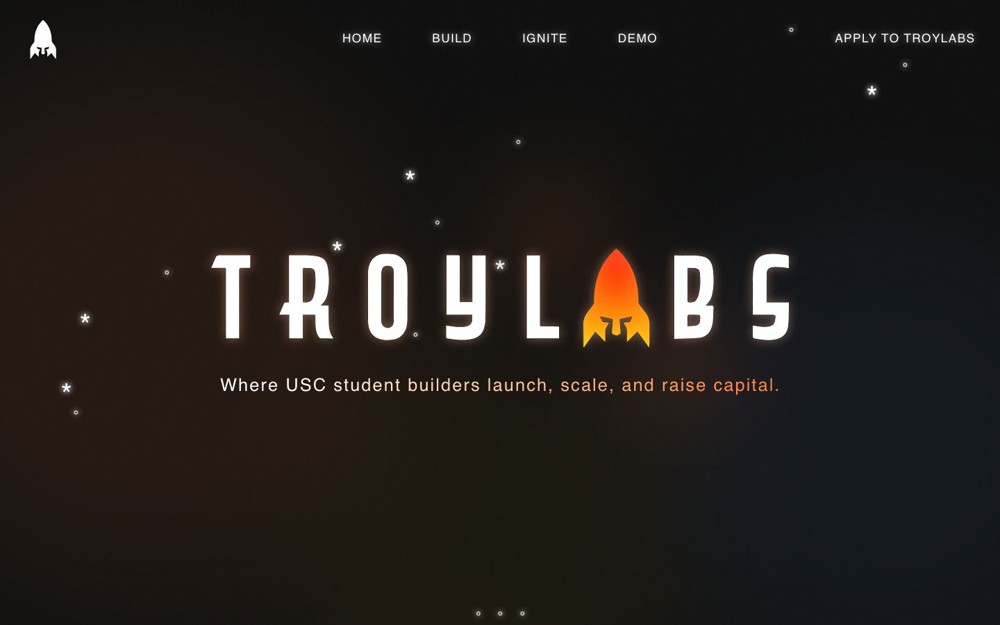
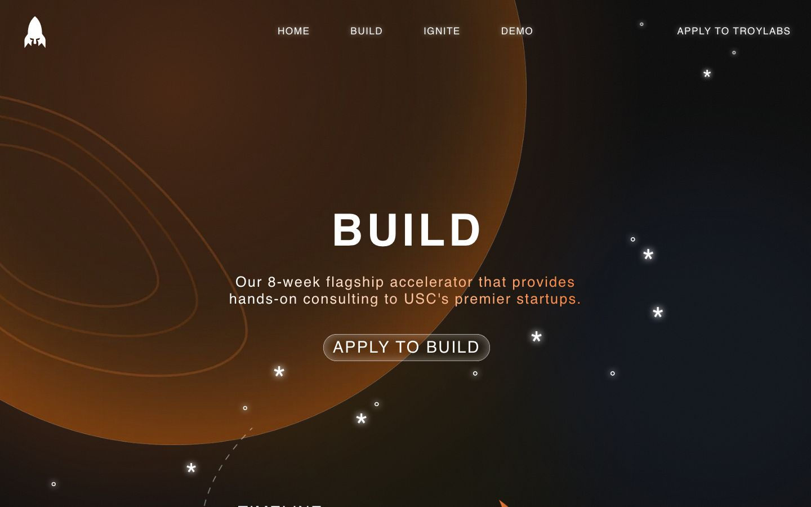
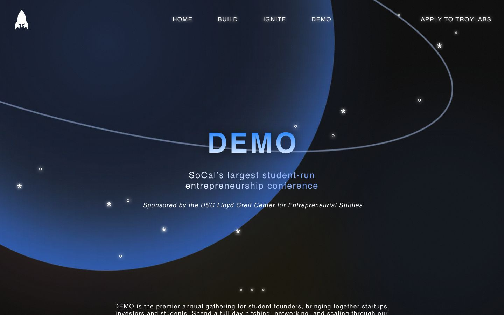
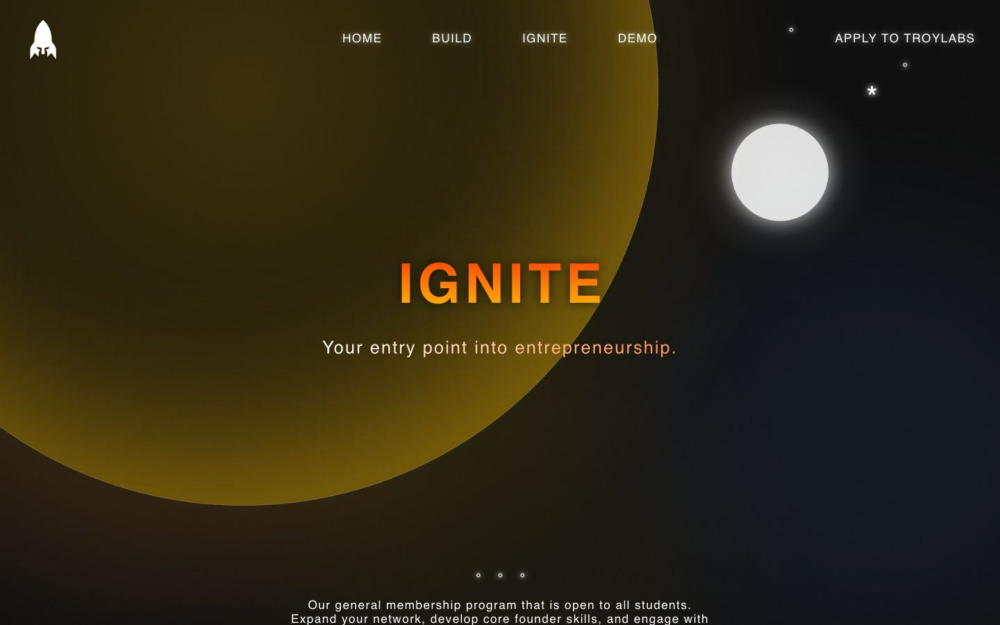
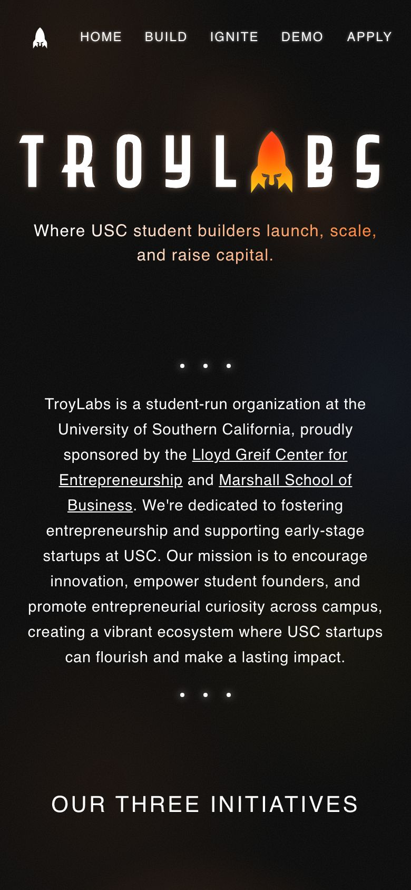

<picture>
  <source media="(prefers-color-scheme: dark)" srcset="docs/images/wordmark-dark.png">
  
</picture>

**Where USC student builders launch, scale, and raise capital.**

The website of USC TroyLabs, a student-run startup accelerator at the University of Southern California.

---

## Pages

| BUILD | DEMO |
|---|---|
|  |  |
| **IGNITE** | **On a phone** |
|  |  |

- **BUILD**: an 8-week accelerator with hands-on consulting for USC's startups
- **DEMO**: SoCal's largest student-run entrepreneurship conference
- **IGNITE**: the general membership program, open to every student

---

## Tech Stack

![Astro] ![TypeScript] ![React] ![TailwindCSS] ![Supabase] ![Vercel] ![Playwright] ![GitHub Actions]

- **Astro** for fast, static pages, with **React** for the interactive parts
- **TypeScript** throughout
- **Tailwind CSS** for styling
- **Supabase** (Postgres) for data and sign-in
- **Vercel** for hosting
- **Playwright** and **GitHub Actions** run the tests on every change

---

## Highlights

- **Motion with restraint**: a rocket that flies the length of the home page, a live star field, planets that drift as you scroll. All of it turns off for visitors who ask their device to reduce motion.
- **Built for phones too**: every section has its own phone layout, not a shrunken desktop.
- **Fast**: plain HTML and CSS with a small amount of JavaScript, so pages load quickly even on campus Wi-Fi.

---

© 2026 TroyLabs. All rights reserved.

[Astro]: https://img.shields.io/badge/astro-%23BC52EE.svg?style=for-the-badge&logo=astro&logoColor=white
[TypeScript]: https://img.shields.io/badge/typescript-%23007ACC.svg?style=for-the-badge&logo=typescript&logoColor=white
[React]: https://img.shields.io/badge/react-%2320232a.svg?style=for-the-badge&logo=react&logoColor=%2361DAFB
[TailwindCSS]: https://img.shields.io/badge/tailwindcss-%2338B2AC.svg?style=for-the-badge&logo=tailwind-css&logoColor=white
[Supabase]: https://img.shields.io/badge/supabase-%233ECF8E.svg?style=for-the-badge&logo=supabase&logoColor=white
[Vercel]: https://img.shields.io/badge/vercel-%23000000.svg?style=for-the-badge&logo=vercel&logoColor=white
[Playwright]: https://img.shields.io/badge/playwright-%232EAD33.svg?style=for-the-badge&logo=playwright&logoColor=white
[GitHub Actions]: https://img.shields.io/badge/github%20actions-%232671E5.svg?style=for-the-badge&logo=githubactions&logoColor=white
